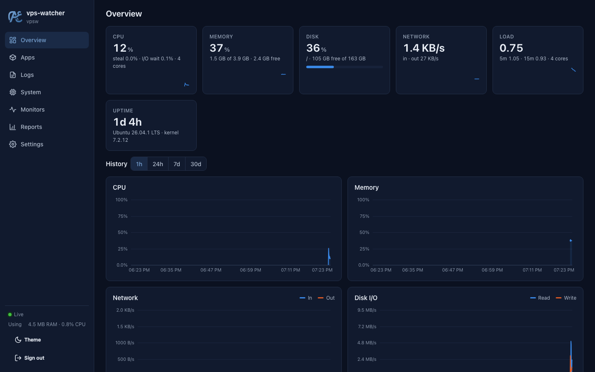
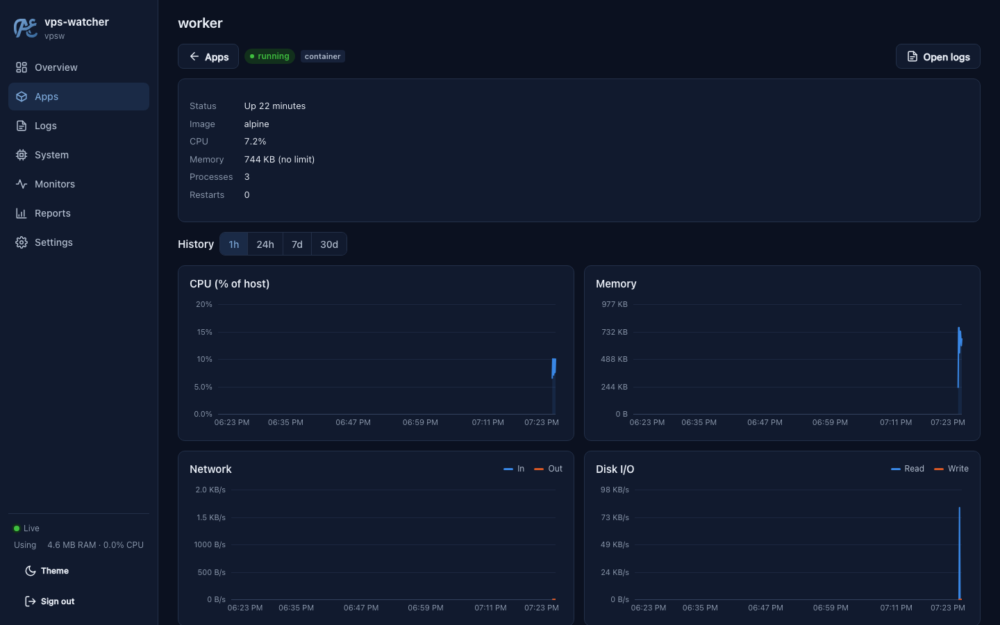
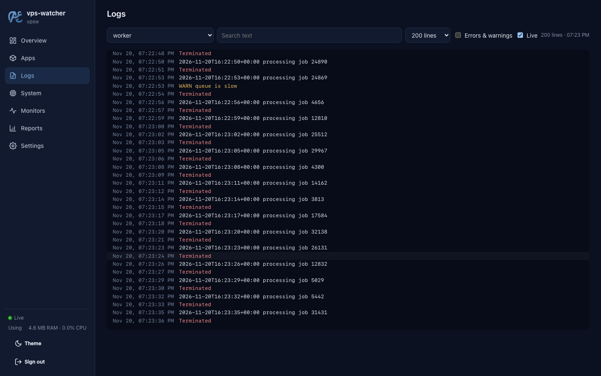
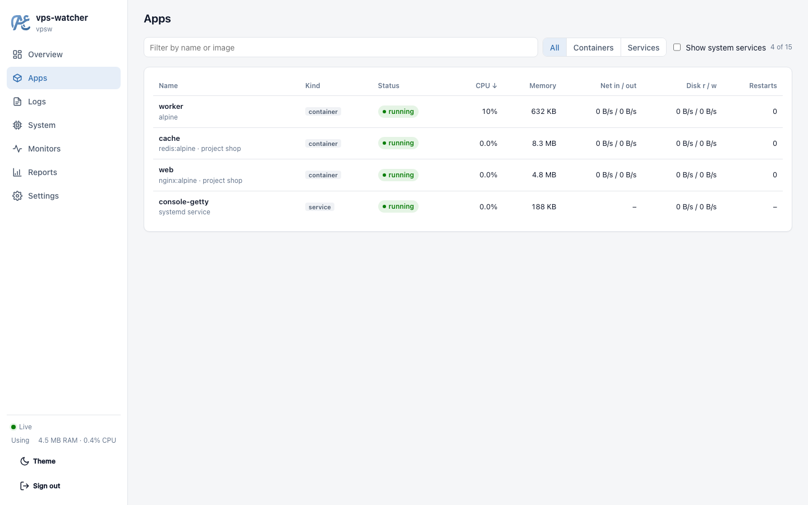
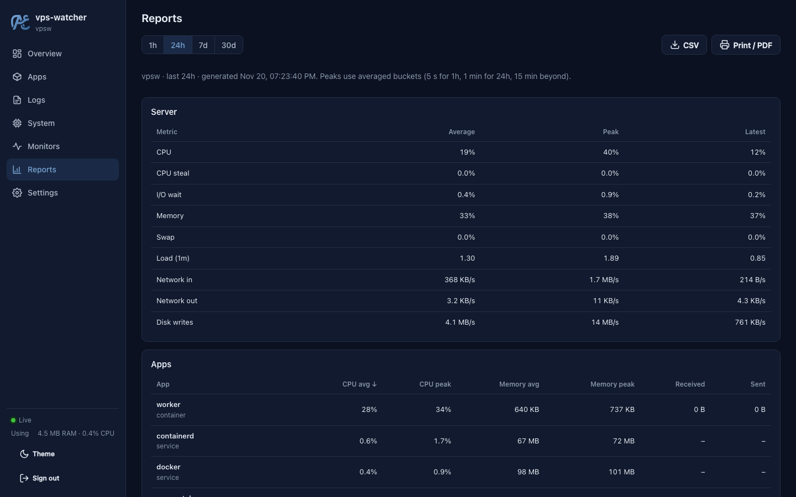
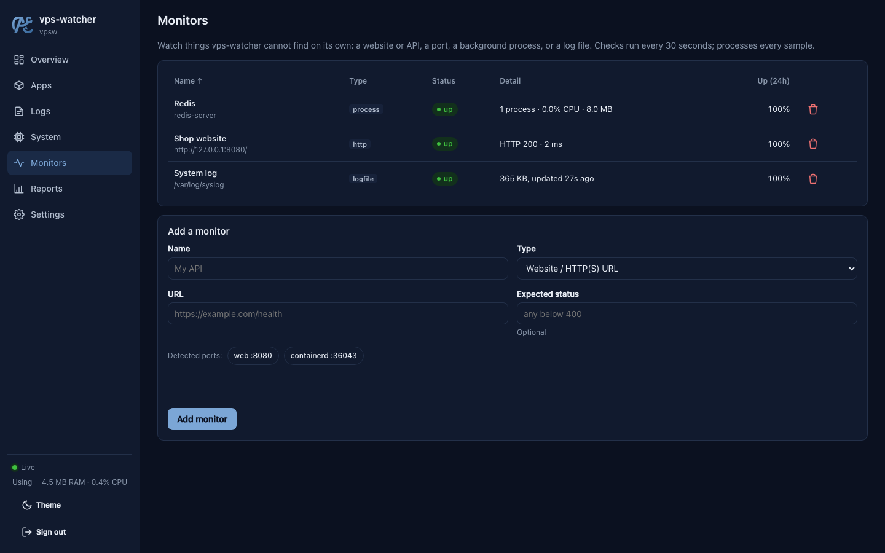
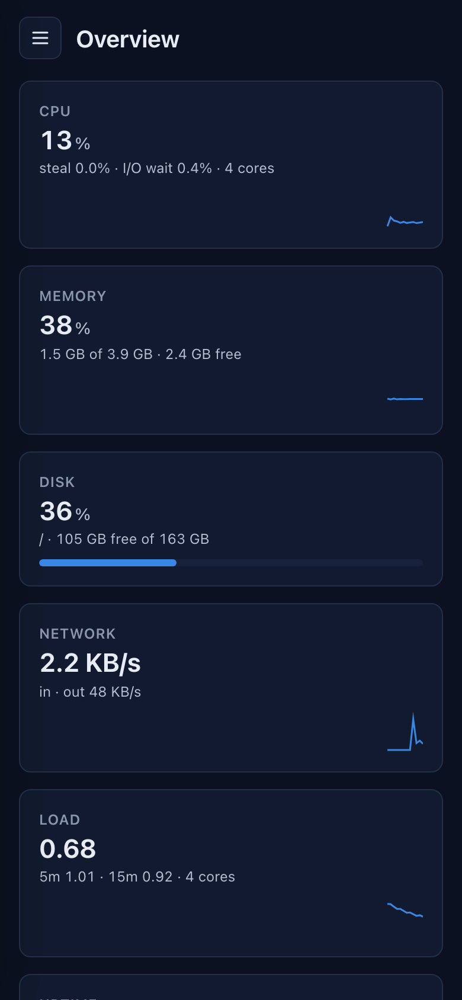

<p align="center">
  
</p>

<h1 align="center">vps-watcher</h1>

<p align="center">
  A tiny, fast and secure monitor for one VPS.<br>
  One 3 MB binary · about 5 MB of RAM · close to 0% CPU · free and open source.
</p>

<p align="center">
  
</p>

Most monitoring stacks cost a small VPS a big share of its CPU and RAM. vps-watcher costs almost nothing. It finds what runs on your server by itself, including Docker containers, systemd services, listening ports, disks and network interfaces, and shows usage, history, logs and reports in a clean web UI.

## Contents

- [Features](#features)
- [Install](#install)
- [First sign-in](#first-sign-in)
- [Put it on your domain](#put-it-on-your-domain)
- [Using the dashboard](#using-the-dashboard)
- [Alerts and email reports](#alerts-and-email-reports)
- [Using an AI assistant](#using-an-ai-assistant)
- [Settings](#settings)
- [Upgrade, reset or remove](#upgrade-reset-or-remove)
- [How it stays light](#how-it-stays-light)
- [Security](#security)
- [Troubleshooting](#troubleshooting)
- [Build from source](#build-from-source)
- [Author](#author)
- [License](#license)

## Features

- **Finds everything on its own.** Docker and Podman containers (grouped by Compose project), systemd services, failed units, listening ports with their owning process, disks and network interfaces. No agents, no plugins, no AI.
- **The whole host.** CPU (with steal and I/O wait, which matter on a VPS), memory, swap, load, disk space and inodes, disk I/O, network traffic and uptime.
- **Every app.** CPU, memory and its limit, network, disk I/O, process count, restarts, health checks and out-of-memory kills.
- **Logs.** Containers, services (journald) and log files under `/var/log`. Live tail, search, and an errors-and-warnings filter.
- **History.** 1 hour at 5-second detail, 48 hours at 1 minute and 30 days at 15 minutes, kept in a fixed-size file.
- **Monitors you add.** Website or API (HTTP/HTTPS), TCP port, process (by name or command line) and log file. vps-watcher suggests the ports it detects.
- **Alerts by email and webhook.** High or spiking CPU, memory and load, full disks, sites that go down, containers that stop or run out of memory, and failed services. Emails come as clean HTML tables showing the server's state and its busiest apps, so you know whether to fix an app or add resources. Webhooks work with Slack, Discord, ntfy or your own endpoint.
- **Reports.** Averages and peaks per app, availability per monitor and a "disk full in N days" forecast, with CSV export, print to PDF, and email on demand or daily/weekly.
- **Secure by default.** Listens on localhost only. You create the admin on first visit. Passwords are hashed with argon2id, and logins are rate-limited.
- **Light and dark themes**, keyboard support and a layout that works on phones.

### Screenshots

| | |
|---|---|
|  |  |
|  |  |
|  |  |

## Install

You need a Linux server with systemd, on x86_64 or ARM64. Docker is optional.

```sh
curl -fsSL https://raw.githubusercontent.com/C3ZIZ/vps-watcher/main/install.sh | sudo sh
```

The installer:

1. Downloads the latest release and checks its SHA-256.
2. Creates a `vps-watcher` system user with read access to Docker and logs.
3. Writes settings to `/etc/vps-watcher/vps-watcher.env`.
4. Starts a hardened systemd service on `127.0.0.1:9100`.

To install a specific version, run `... | sudo sh -s -- --version v26.11.20.19.30`.

## First sign-in

vps-watcher is not public yet. Reach it through an SSH tunnel from your computer:

```sh
ssh -L 9100:127.0.0.1:9100 you@your-server
```

Open <http://localhost:9100>. The first visit shows **Create admin**. Enter your email and a password of at least 12 characters, and you are in.

> For safety, the admin account can only be created from the server itself (localhost or the SSH tunnel), never through a public domain. Nobody can claim your dashboard before you do.

## Put it on your domain

1. Point a DNS record (for example `watch.example.com`) at your server.
2. Set the domain in `/etc/vps-watcher/vps-watcher.env`:

   ```sh
   VPSW_DOMAIN=watch.example.com
   ```

3. Print a ready-made config for your web server and follow the comments at its top.

   **Caddy** (gets the HTTPS certificate automatically):

   ```sh
   sudo vps-watcher proxy caddy | sudo tee -a /etc/caddy/Caddyfile
   sudo systemctl reload caddy
   ```

   **nginx** (then add HTTPS with certbot):

   ```sh
   sudo vps-watcher proxy nginx | sudo tee /etc/nginx/sites-available/vps-watcher
   sudo ln -s /etc/nginx/sites-available/vps-watcher /etc/nginx/sites-enabled/
   sudo nginx -t && sudo systemctl reload nginx
   sudo certbot --nginx -d watch.example.com
   ```

vps-watcher keeps listening on localhost; only your web server talks to it.

### Login or open

| `VPSW_AUTH` | Who can see the dashboard | Who can change things |
|---|---|---|
| `login` (default) | Only the signed-in admin | The admin |
| `open` | Anyone with the link | The admin (sign in from the sidebar) |

In `open` mode, logs and process command lines stay private, because they often contain secrets. Set `VPSW_OPEN_LOGS=true` only if you are sure they hold nothing sensitive.

## Using the dashboard

| Page | What you get |
|---|---|
| **Overview** | Live tiles for CPU, memory, disk, network, load and uptime; history charts for 1h, 24h, 7d or 30d; top apps; monitors; disks |
| **Apps** | Every container and service with live usage. Filter, sort, and click a row for its charts, details and recent logs |
| **Logs** | Pick a container, service or file. Search, follow live, or show only errors and warnings |
| **System** | Processes (top CPU and memory), listening ports with their owner, disks and network interfaces |
| **Monitors** | Add HTTP(S), TCP, process or log-file checks and see their status, response time and 24h availability |
| **Alerts** | What is firing now, the last 200 alert events, the rules in effect, and (for the admin) where alerts go, with a **Send test alert** button |
| **Reports** | Averages and peaks for the server and each app, availability, and disk-full forecasts. Download CSV, print to PDF or email it |
| **Settings** | Change your email or password, sign out other browsers, pick a theme, and see vps-watcher's own usage |

Charts support hover and the arrow keys. Every page updates live while it is open and stops working when the tab is hidden.

## Alerts and email reports

Alerts work out of the box: they appear on the **Alerts** page and as a red strip on the Overview. To also get them by email or webhook, add a few lines to `/etc/vps-watcher/vps-watcher.env`. For Gmail with an [app password](https://myaccount.google.com/apppasswords):

```sh
VPSW_ALERT_EMAIL=you@example.com
VPSW_SMTP_HOST=smtp.gmail.com
VPSW_SMTP_USER=your.account@gmail.com
VPSW_SMTP_PASSWORD='abcd efgh ijkl mnop'

# and/or a webhook (Slack, Discord, ntfy or your own URL)
VPSW_WEBHOOK_URL=https://hooks.slack.com/services/...
```

Then check, restart and test:

```sh
sudo vps-watcher config && sudo systemctl restart vps-watcher && sudo vps-watcher test-alert
```

Default rules:

| Rule | Default |
|---|---|
| CPU or memory high | 90% or more for 5 minutes |
| CPU or memory spike | 98% or more for 1 minute (critical) |
| Load | above 2 per CPU core for 5 minutes |
| Disk space or inodes | 90% or more |
| Monitors | down for two checks in a row |
| Apps | container stopped, unhealthy, restarted or out of memory; service failed; Docker unreachable |

[docs/alerts.md](docs/alerts.md) covers everything else:

- every rule and how to change it
- Microsoft 365 and Gmail with OAuth2
- Amazon SES, Mailgun and local relays
- webhook formats and signature checking
- daily or weekly report emails
- troubleshooting

## Using an AI assistant

You can ask an AI assistant to install and configure vps-watcher for you. Give it this link: [docs/ai-install.md](docs/ai-install.md). That runbook tells the assistant how to do the whole setup without reading, printing or storing your passwords and tokens. When a secret is needed, the assistant asks you to type it yourself:

```sh
sudo vps-watcher set VPSW_SMTP_PASSWORD     # prompts with typing hidden
```

`vps-watcher set` refuses secrets passed as arguments, so they never land in shell history. Agents working on the code itself read [AGENTS.md](AGENTS.md), which covers the architecture, conventions and security rules.

## Settings

All settings live in `/etc/vps-watcher/vps-watcher.env`. Run `sudo systemctl restart vps-watcher` after a change.

| Variable | Default | Meaning |
|---|---|---|
| `VPSW_LISTEN` | `127.0.0.1:9100` | Address of the web UI |
| `VPSW_AUTH` | `login` | `login` or `open` (see above) |
| `VPSW_OPEN_LOGS` | `false` | In `open` mode, also show logs and command lines publicly |
| `VPSW_DOMAIN` | | Your domain, used by `vps-watcher proxy caddy` and `proxy nginx` |
| `VPSW_INTERVAL` | `5` | Seconds between samples (1–60) |
| `VPSW_TRUSTED_PROXIES` | `127.0.0.1,::1` | Proxies whose `X-Forwarded-For` header is trusted |
| `VPSW_DATA_DIR` | `/var/lib/vps-watcher` | Where the admin account, monitors and history are stored |
| `VPSW_DOCKER_SOCKET` | `/var/run/docker.sock` | Docker socket; if it is missing, vps-watcher shows no containers |
| `VPSW_ALERT_CPU`, `VPSW_ALERT_MEMORY` | `90` | Percent that alerts after `VPSW_ALERT_AFTER` minutes; `off` disables |
| `VPSW_ALERT_AFTER` | `5` | Minutes CPU, memory or load must stay high |
| `VPSW_ALERT_SPIKE` | `98` | CPU or memory percent that alerts after 1 minute |
| `VPSW_ALERT_LOAD` | `2` | Load per CPU core that counts as overloaded |
| `VPSW_ALERT_DISK` | `90` | Disk space or inodes percent |
| `VPSW_ALERT_APPS` | `true` | Alerts for stopped, unhealthy, restarted or failed apps |
| `VPSW_ALERT_EMAIL` | | Alert and report recipients, separated by commas |
| `VPSW_SMTP_HOST`, `_PORT`, `_SECURITY`, `_USER`, `_PASSWORD`, `_FROM` | | Mail server and sign-in ([guide](docs/alerts.md#set-up-email)) |
| `VPSW_SMTP_OAUTH_CLIENT_ID`, `_CLIENT_SECRET`, `_REFRESH_TOKEN`, `_TOKEN_URL` | | OAuth2 sign-in instead of a password |
| `VPSW_WEBHOOK_URL`, `_FORMAT`, `_SECRET`, `_TOKEN` | | Webhook target, format, signing key and bearer token |
| `VPSW_REPORT` | `off` | Email a usage report `daily` or `weekly` |

Run `sudo vps-watcher config` after editing. It checks the file and prints the effective settings with every secret hidden. You can also change one setting at a time without opening the file: `sudo vps-watcher set VPSW_DOMAIN watch.example.com`. For secrets, leave out the value and type it at the hidden prompt.

## Upgrade, reset or remove

| Task | Command |
|---|---|
| Upgrade | Run the install command again. Settings and history are kept. Settings added in new versions are listed in `/etc/vps-watcher/vps-watcher.env.example` |
| Check settings | `sudo vps-watcher config` (secrets hidden) |
| Test alerts | `sudo vps-watcher test-alert` |
| Forgot password | `sudo vps-watcher reset-admin && sudo systemctl restart vps-watcher`, then create the admin again through the SSH tunnel |
| Uninstall (keep data) | `curl -fsSL https://raw.githubusercontent.com/C3ZIZ/vps-watcher/main/install.sh \| sudo sh -s -- --uninstall` |
| Uninstall everything | Same command with `--purge` |
| Service logs | `journalctl -u vps-watcher -f` |
| Version | `vps-watcher version` |

## How it stays light

Measured on a 4-core Ubuntu 26.04 server running Docker with three containers:

| | vps-watcher |
|---|---|
| Binary | about 3.2 MB, static, no runtime dependencies |
| Memory (RSS) | about 5 MB (4–9 MB) |
| CPU at idle | about 0.2% of one core |
| Threads | 1–2 |
| History on disk | at most about 23 KB per series, fixed size |

How:

- It reads `/proc` and the cgroup files directly. It never calls Docker's stats API, which makes the Docker daemon work hard for every container.
- One thread runs both the sampler and the web server. A sample reads a handful of small kernel files and takes about a millisecond.
- Heavy work (the process list, port-to-process mapping, logs) runs only while you look at it.
- Charts are drawn on a canvas by about 200 lines of plain JavaScript. No frameworks, no CDN, nothing to download.
- The systemd unit caps the service at 128 MB of memory, 50% CPU and 32 tasks, so the monitor can never become the problem.

## Security

- **Network.** Listens on `127.0.0.1` by default. Public access goes through your HTTPS reverse proxy.
- **First run.** The admin can be created only from a direct localhost connection. Create it right after installing.
- **Passwords.** argon2id (19 MiB, 2 passes), at least 12 characters. Logins are limited to 10 attempts per IP (per /64 for IPv6) per 15 minutes, with at most two password checks at a time.
- **Abuse limits.** 16 KB request bodies, 10 seconds to send headers, 30 seconds per request, 256 connections and 32 live streams at most.
- **Log files** are opened without following symbolic links, so a swapped file cannot expose `/etc/shadow` or hang the service.
- **Sessions.** Random 256-bit tokens in HttpOnly, SameSite=Strict cookies, marked Secure behind HTTPS, ending after 7 idle days. Changing your password signs out every other session.
- **Browser protection.** A strict Content Security Policy (no inline scripts, no third-party code), cross-site request blocking, no framing, no referrer.
- **Alert secrets.** SMTP passwords, OAuth tokens and webhook URLs stay in the env file (`0640`, root and the service group). They are never logged, shown in the UI or printed by `vps-watcher config`. Mail always uses verified TLS, and a password is never sent unencrypted to another machine.
- **Least privilege.** The service runs as its own user under a read-only, sandboxed systemd unit. It only reads; it never starts, stops or changes your apps.
- **About Docker access.** Reading container info requires the `docker` group, and on most hosts that group is as powerful as root. vps-watcher only sends read-only `GET` requests. Keep the dashboard behind login if that matters to you.

Report a vulnerability privately as described in [SECURITY.md](SECURITY.md).

## Troubleshooting

**"Finish setup on the server" appears on my domain.** Create the admin through the SSH tunnel first (see [First sign-in](#first-sign-in)), then sign in on your domain.

**No containers are listed.** Check that Docker runs and that the user is in the docker group: `id vps-watcher`. Then restart: `sudo systemctl restart vps-watcher`.

**Live view says "Stale".** The page lost its connection. If you use nginx, keep `proxy_buffering off;` from the generated config, because live updates use Server-Sent Events.

**A log file is missing from Logs.** vps-watcher lists `*.log` files under `/var/log`. Add any other file as a **Log file** monitor and it appears in Logs too.

**Alerts are not arriving.** Run `sudo vps-watcher test-alert`, which prints each channel's error. The [alerts troubleshooting table](docs/alerts.md#troubleshooting) explains the common ones, such as blocked SMTP ports and Gmail needing an app password.

**Port owners show "unknown".** The service needs the `CAP_SYS_PTRACE` capability that the provided unit grants. If you run the binary by hand, run it as root.

## Build from source

You need Rust 1.88 or newer.

```sh
git clone https://github.com/C3ZIZ/vps-watcher.git
cd vps-watcher
cargo build --release
./target/release/vps-watcher           # serves on 127.0.0.1:9100
```

Read [docs/design.md](docs/design.md) for the architecture and [CONTRIBUTING.md](CONTRIBUTING.md) for the workflow.

## Author

vps-watcher is created and maintained by **Abdulaziz Hafiz**.

- Portfolio: [AHafiz.sa](https://ahafiz.sa)
- Email: [abdulazizhafez2004@gmail.com](mailto:abdulazizhafez2004@gmail.com)
- GitHub: [@C3ZIZ](https://github.com/C3ZIZ)

## License

Copyright © 2026 Abdulaziz Hafiz. The copyright stays with the author, and the code is free and open-source software under the [MIT License](LICENSE). You may use, copy, change, merge, publish, distribute, sublicense and sell copies of it, provided the copyright notice and the license text stay in all copies or substantial parts. The software comes with no warranty of any kind.
